<p align="center">
  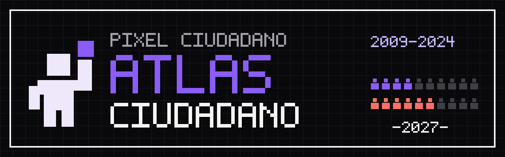
</p>

# Atlas ciudadano

Sitio web interactivo para explorar la participación ciudadana en las elecciones federales de México de 2009 a 2024, por estado, municipio, sexo y edad. Lo desarrolló el equipo **Pixel Ciudadano** para el hackathon del INE 2026, Reto 3: Comunicación y visualización con impacto público.

El objetivo es explicar con datos verificables quién vota y quién no, y cuál es el reto rumbo a la elección intermedia de 2027.

> Proyecto independiente. No es un sitio oficial del INE.

## Contenido

- [Funcionalidades](#funcionalidades)
- [Capturas](#capturas)
- [Datos y metodología](#datos-y-metodología)
- [Tecnología](#tecnología)
- [Estructura del repositorio](#estructura-del-repositorio)
- [Instalación y uso local](#instalación-y-uso-local)
- [Despliegue](#despliegue)
- [Equipo](#equipo)
- [Derechos](#derechos)

## Funcionalidades

**Mapa y fichas**
- Mapa de los 32 estados, 6 regiones y los municipios del país para las elecciones de 2009, 2012, 2015, 2018, 2021 y 2024.
- Ficha por estado con:
  - participación y lugar nacional;
  - comparación con el país;
  - tres indicadores: mujeres frente a hombres, jóvenes frente a mayores de 60 y cambio respecto a la elección anterior del mismo tipo.
- Ficha por municipio con su lugar dentro del estado, la comparación con el estado y la descarga de datos en CSV.
- Filtros combinables por sexo y grupo de edad. Las comparaciones se ajustan al grupo seleccionado.
- Buscador de estados y municipios.

**Recorrido guiado**
- Siete pasos que resumen los hallazgos principales: diferencias entre estados, entre mujeres y hombres, entre grupos de edad, entre elecciones presidenciales e intermedias y entre municipios.
- Cierra con un escenario hipotético para 2027: si los jóvenes votaran como las personas de 60 o más.

**Tu dato**
- Comparativo personalizado a partir del estado, la edad y el sexo de quien lo usa.
- El cálculo ocurre en el navegador; no se guarda ni se envía información.

**Misión 2027**
- Cuestionario de cinco preguntas con datos reales, explicación de cada respuesta y una tarjeta del estado al final.

**Compartir**
- Genera imágenes verticales (1080×1920) de cualquier vista, de Tu dato y del resultado del cuestionario, con fuente y año.

**Otras funciones**
- Modo presentación para proyectar en clases o reuniones.
- Tutorial de uso del mapa.
- Interfaz en español e inglés, tema claro y oscuro, y diseño adaptado a celular.

## Capturas

| Inicio | Recorrido guiado |
|---|---|
| 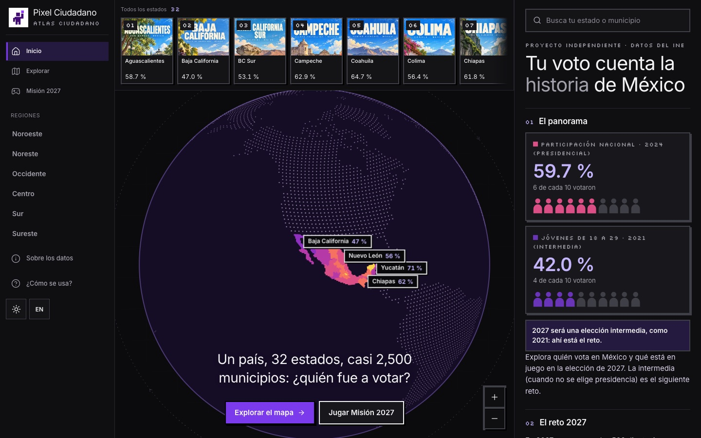 | 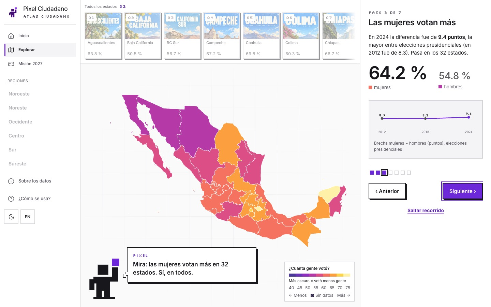 |

| Escenario 2027 | Ficha de estado |
|---|---|
| 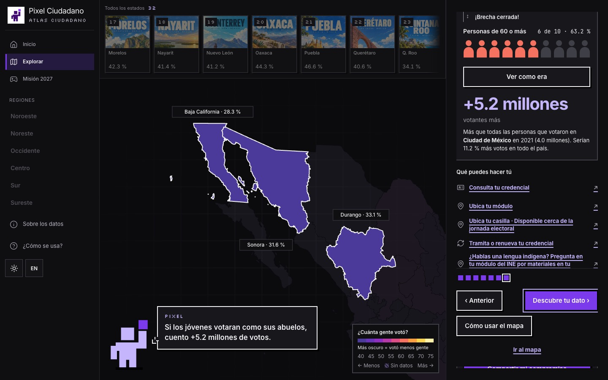 | 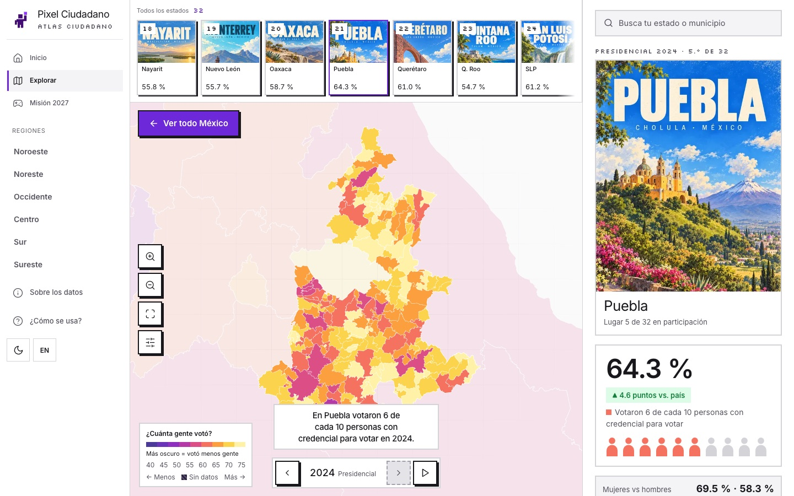 |

| Filtros por sexo y edad | Modo presentación |
|---|---|
| 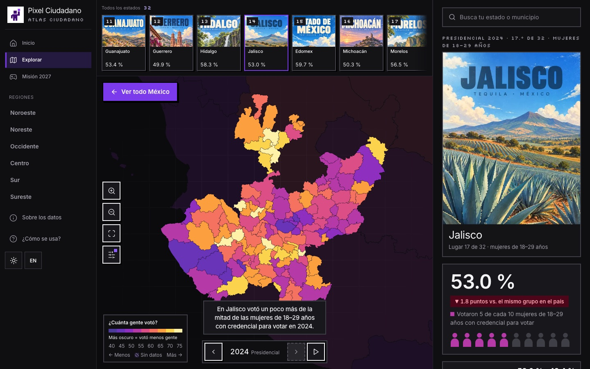 | 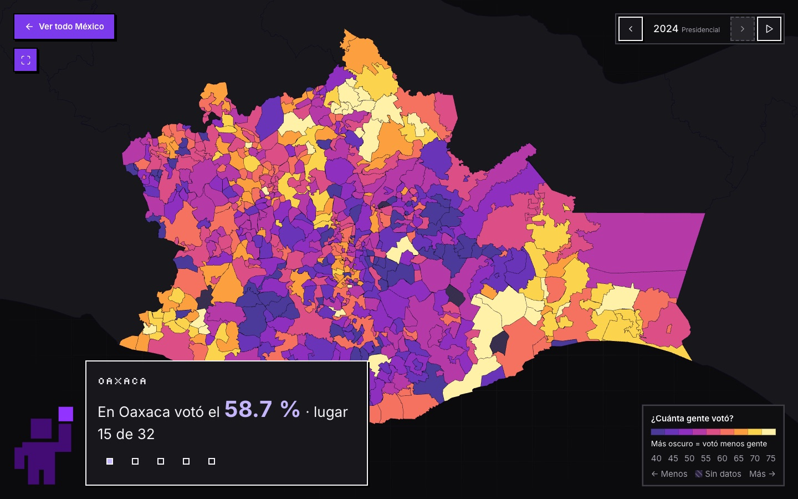 |

| Misión 2027 | Tu dato |
|---|---|
| 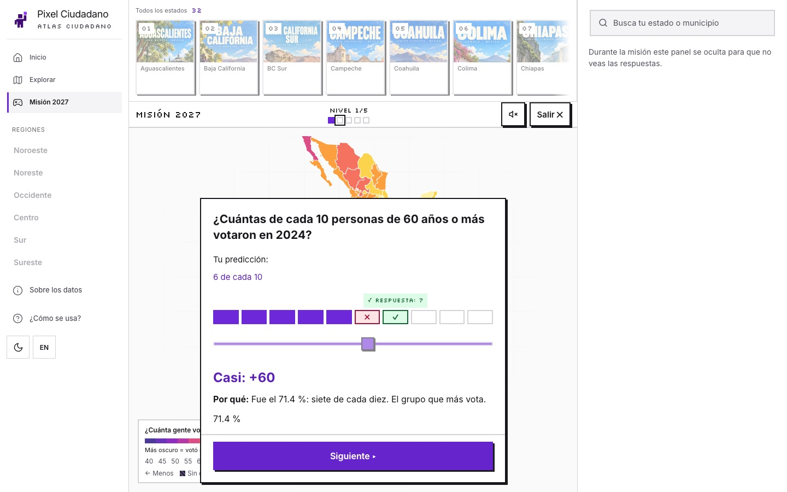 | 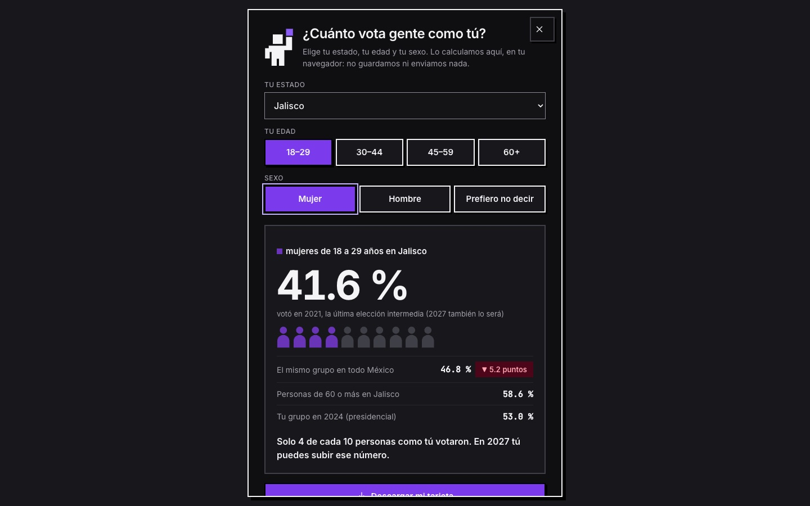 |

| Imagen para compartir | Tutorial |
|---|---|
| 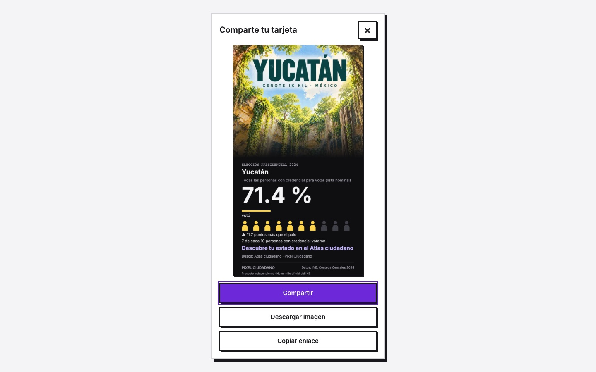 | 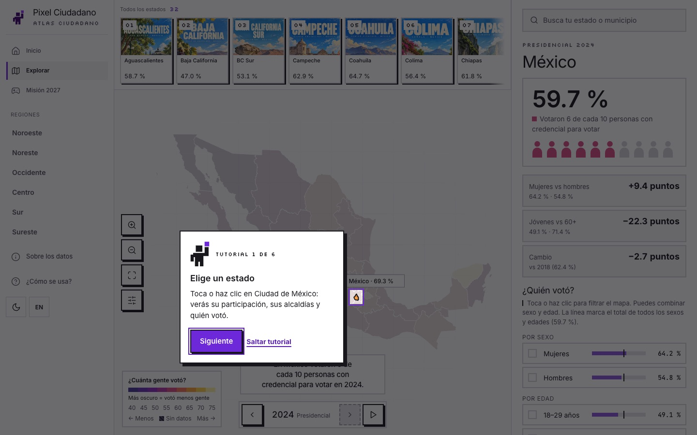 |

Versión para celular:

<p>
  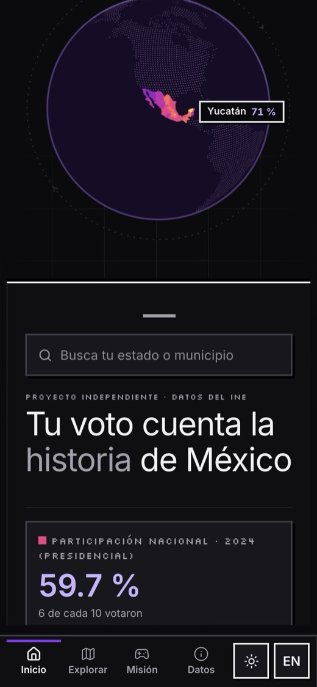
  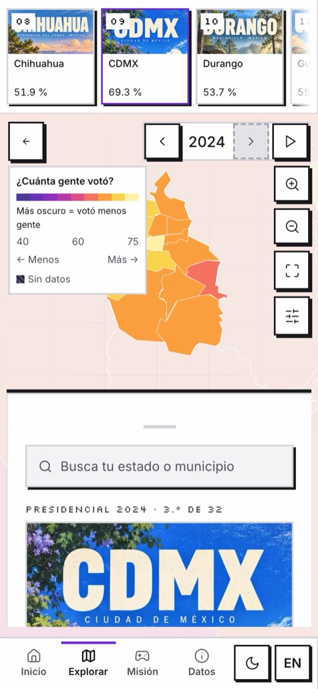
  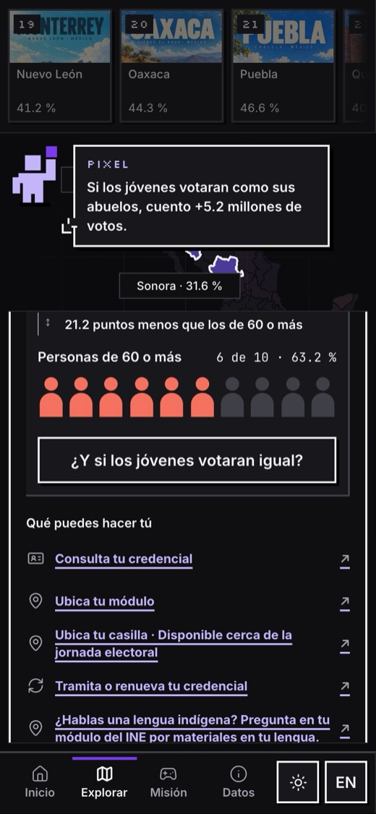
</p>

## Datos y metodología

- **Fuente:** Instituto Nacional Electoral, [Conteos Censales de Participación Ciudadana](https://ine.mx/transparencia/datos-abiertos/visualizacion-datos/conteos-censales-participacion/) 2009–2024.
- **Geometrías:** INEGI (entidades y municipios).
- **Cálculo:**

  ```
  participación = votos / (lista nominal − registros sin sexo o edad especificados)
  ```

- **Validación:**
  - Los archivos fuente se compararon por su huella SHA-256 con los publicados por el INE.
  - Las cifras estatales de 2024 coinciden con la Tabla General de los Conteos Censales.
  - Las cifras que muestra el sitio se recalcularon con los scripts de `scripts/`.
- **Diferencias entre porcentajes:** se calculan con los valores redondeados a un decimal, para que coincidan con lo que se muestra.
- **Limitaciones:** no incluye casillas especiales ni voto en el extranjero, y puede diferir del cómputo oficial de cada elección.

## Tecnología

- HTML, CSS y JavaScript (módulos ES), sin frameworks ni proceso de compilación.
- Mapa en SVG y globo en Canvas 2D.
- Datos en JSON, generados con Python a partir de los archivos del INE.
- Accesibilidad:
  - navegación con teclado;
  - contraste AA en ambos temas;
  - soporte de `prefers-reduced-motion`.

## Estructura del repositorio

```
dist/                Sitio publicado
  index.html
  app.js             Estado de la aplicación, mapa, fichas, filtros y navegación
  demo.js            Recorrido guiado y gráficas
  game.js            Misión 2027
  globe.js           Globo de la portada
  tutorial.js        Tutorial de uso
  share.js           Generación de imágenes para compartir
  you.js             Tu dato
  i18n.js            Textos en español e inglés
  *.css              Estilos
  assets/            Datos, geometrías e ilustraciones
scripts/             Procesamiento y validación de datos
entregables/         Documentos del reto (guion, pitch, bases)
fuentes/             Geometrías de origen
docs/                Imágenes del README
```

## Instalación y uso local

No hay dependencias que instalar; basta un servidor estático. Arráncalo en `dist/`:

```bash
cd dist
python3 -m http.server 4173
```

Abre http://localhost:4173 en el navegador.

Para comprobar que los textos en español e inglés tengan las mismas claves, ejecuta desde `dist/`:

```bash
node ../scripts/check-i18n.mjs
```

## Despliegue

El contenido de `dist/` se publica tal cual en cualquier hosting estático. Para Cloudflare Pages:

- **Directorio de salida:** `dist`.
- **Comando de build:** ninguno.

También se puede desplegar con Wrangler:

```bash
npx wrangler pages deploy dist --project-name atlas-ciudadano --branch main
```

Los archivos `_headers`, `404.html` y `robots.txt` ya están incluidos en `dist/`.

## Equipo

Pixel Ciudadano · Hackathon INE 2026, Reto 3.

## Derechos

Los derechos de este proyecto se ceden al Instituto Nacional Electoral conforme a las bases de la convocatoria (ver [`LICENSE`](LICENSE)). Los datos pertenecen al INE y las geometrías al INEGI, y se rigen por sus propios términos de uso.
